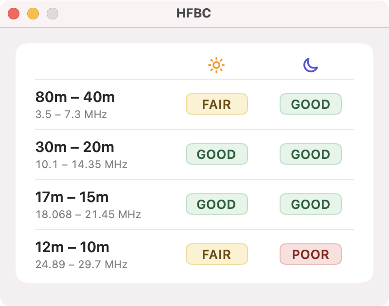

# HFBC

HFBC is a macOS desktop application that displays current HF band conditions for the 80m–40m, 30m–20m, 17m–15m and 12m–10m bands. It is intended as a resource for amateur radio operators.

## Requirements

- macOS Sequoia (15)

## Acknowledgements

- Solar and band data courtesy of [HAMQSL.com](https://www.hamqsl.com/solar.html) (N0NBH)

## Questions, Feature Requests, Feedback

You can log and bugs and feature requests on the [issues page](https://github.com/mikechambers/HFBC/issues).

## License

Project released under a [MIT License](LICENSE.md).

